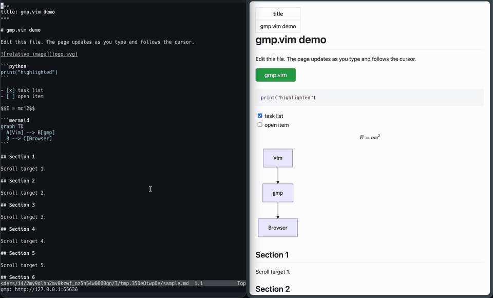

# goda-mp.vim

Markdown preview for Vim and Neovim, right in your browser.



goda-mp.vim is a port of [bufpreview.vim](https://github.com/kat0h/bufpreview.vim) from [denops.vim](https://github.com/vim-denops/denops.vim) to [goda.vim](https://github.com/Shougo/goda.vim). It replaces Deno with a Go binary that bundles the preview page and its assets directly, so you can preview files without network access.

## Features

- Works in Vim and Neovim
- Live preview updates as you type and follows your cursor
- Syntax highlighting, YAML front matter, task lists, KaTeX, Mermaid, and PlantUML support
- Relative images resolve from the Markdown file's directory

PlantUML diagrams are fetched from the public PlantUML server, matching bufpreview.vim's behavior.

## Requirements

- Vim 9.1 with `+job` and `+channel`, or Neovim 0.11
- [goda.vim](https://github.com/Shougo/goda.vim)
- [Nix](https://nixos.org) with flakes enabled, or [Go](https://go.dev) 1.26 and [npm](https://www.npmjs.com), to build the binary
- A browser

Windows is not supported.

## Installation

### Using a plugin manager

Install both goda.vim and goda-mp.vim, then run `nix build` inside the plugin directory. The plugin expects the binary at `result/bin/goda-mp`.

With [lazy.nvim](https://github.com/folke/lazy.nvim):

```lua
{
  'airRnot1106/goda-mp.vim',
  dependencies = { 'Shougo/goda.vim' },
  build = 'nix build',
}
```

With [vim-plug](https://github.com/junegunn/vim-plug):

```vim
Plug 'Shougo/goda.vim'
Plug 'airRnot1106/goda-mp.vim', { 'do': 'nix build' }
```

With [dein.vim](https://github.com/Shougo/dein.vim):

```vim
call dein#add('Shougo/goda.vim')
call dein#add('airRnot1106/goda-mp.vim', {'build': 'nix build'})
```

### Without Nix

Build the binary with Go and npm instead. Run this inside the plugin directory:

```sh
(cd client && npm ci && npm run build) && go build -o bin/goda-mp .
```

The plugin finds the binary at `bin/goda-mp`. To build on install and update, use this command in place of `nix build` in the plugin manager examples above. For example, with lazy.nvim:

```lua
{
  'airRnot1106/goda-mp.vim',
  dependencies = { 'Shougo/goda.vim' },
  build = '(cd client && npm ci && npm run build) && go build -o bin/goda-mp .',
}
```

### Using Nix Flakes

The default package provides the Vim plugin along with `bin/goda-mp`, and handles the goda.vim dependency automatically. For Home Manager:

```nix
{
  inputs.goda-mp-vim.url = "github:airRnot1106/goda-mp.vim";

  # In your Home Manager module:
  programs.neovim.plugins = [
    inputs.goda-mp-vim.packages.${pkgs.stdenv.hostPlatform.system}.default
  ];
}
```

The flake also outputs `goda-mp` (the binary), `client` (the frontend bundle), and `goda-vim`.

## Quick Start

You can test the preview without touching your config by running:

```sh
nix run github:airRnot1106/goda-mp.vim         # Neovim
nix run github:airRnot1106/goda-mp.vim#vim     # Vim
```

If you already cloned the repo locally, use `nix run` or `nix run .#vim` instead. Extra arguments are passed through to the editor, and the temporary sample file is cleaned up on exit.

## Usage

The following commands are available when editing Markdown:

| Command | Action |
| --- | --- |
| `:PreviewMarkdown` | Start previewing the current buffer, closing any active preview first. |
| `:PreviewMarkdownClose` | Close the active preview. |
| `:PreviewMarkdownToggle` | Toggle the preview on or off. |

To automatically open a preview when opening a Markdown file:

```vim
augroup goda_mp
  autocmd!
  autocmd FileType markdown PreviewMarkdown
augroup END
```

## Options

| Variable | Default | Description |
| --- | --- | --- |
| `g:goda_mp#binary` | Unset | Path to the binary. Overrides `bin/goda-mp` and `result/bin/goda-mp`. |
| `g:goda_mp#open_browser_fn` | `''` | Custom Vim function name to open the preview URL. |
| `g:goda_mp#browser` | `''` | Browser command to use (defaults to system default). |
| `b:goda_mp_server_host`, `g:goda_mp#server_host` | `'127.0.0.1'` | Server listen address. |
| `b:goda_mp_server_port`, `g:goda_mp#server_port` | `0` | Server port (0 chooses an available port). |

The preview URL is printed to `:messages`. If your browser does not open automatically, check `goda#log('mp')`.

## Development

```sh
nix develop
(cd client && npm ci && npm run build)
go test ./...
nix flake check
```

Running `nix flake check` will run the Go tests, E2E tests against actual Vim and Neovim instances, and make sure `go.mod` stays in sync with the `goda-vim` flake input. Keep in mind that Nix flakes ignore untracked files, so remember to `git add` any new files before testing or building.

## Special thanks

- [bufpreview.vim](https://github.com/kat0h/bufpreview.vim)

## License

MIT

The client uses code from [markdown-it-inject-linenumbers](https://github.com/digitalmoksha/markdown-it-inject-linenumbers).
